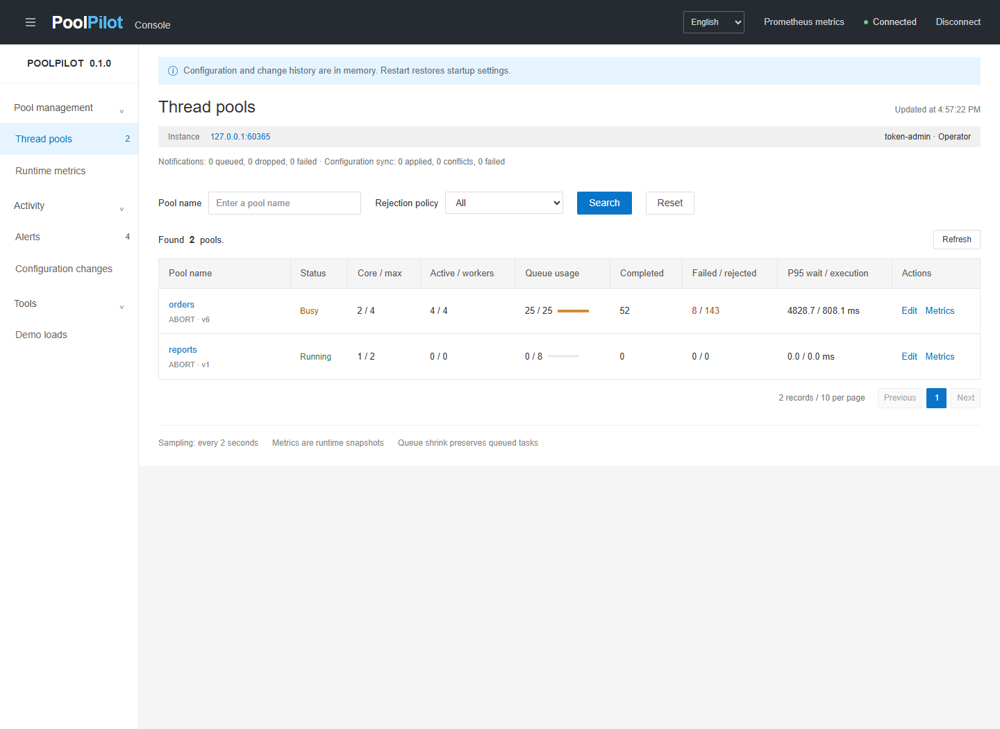

# PoolPilot

[简体中文](README.md) · [English](README.en.md)

[](https://github.com/Htd7860/poolpilot/actions/workflows/ci.yml)

Lightweight thread pool governance for Spring Boot: runtime configuration, local persistence, versioned rollback, in-flight timeouts, external configuration and a Chinese / English console.

Java 17 baseline; tested on Java 17/21 with Spring Boot 3.4.13/3.5.16, default 3.5.16. Artifacts are not available from Maven Central; build and install them locally before integration.

## What it does

Tune core threads, maximum threads, queue capacity, keep-alive, core timeout, rejection policy and slow task threshold without restarting the current instance. Inspect live utilization, queueing, failures, rejections and task timing.

- Resizable queue: shrinking preserves queued work and blocks new queue admissions until occupancy drops below the new capacity.
- Versioned configuration: stale edits return HTTP 409; changes record before / after settings and a reason.
- Local persistence: optional atomic file replacement; restore settings, versions and the latest 200 changes after restart. Failed saves reject the change.
- Rollback: review current and target settings, check the current version, and append a new version with its source change.
- Task observation: detects exceptions captured by directly submitted FutureTask instances, plus observed cancellations.
- Micrometer / Prometheus: pool gauges, task counters and wait / execution histograms; pools registered at runtime are bound too.
- Alerts: activity, queue pressure, rejections, slow tasks and unfinished queue/run timeouts; bounded asynchronous delivery with failure/drop counters.
- External sources: HTTP/Nacos polling, application scope, persisted source revisions and local version conflict protection.
- MDC propagation: restores previous context and composes ordered Spring TaskDecorators.
- Lifecycle: a shared shutdown deadline, followed by interruption and cancellation of queued Futures.
- Optional admin starter: shared tokens, named tokens with read/write roles and expiry, or application authentication.
- Bilingual console: menus, queries, dialogs, alerts, validation and errors; switching preserves unsaved input and filters.



## Run locally

Use a full **JDK 17 or 21**. Maven Wrapper downloads Maven 3.9.16. Verify both `java -version` and `JAVA_HOME`.

An executable JAR is also available from [Releases](https://github.com/Htd7860/poolpilot/releases). Generate and configure an admin token before running it.

Windows PowerShell:

```powershell
$env:JAVA_HOME = 'C:\Program Files\Java\jdk-17'
$env:POOLPILOT_ADMIN_TOKEN = .\scripts\new-admin-token.ps1
Write-Host $env:POOLPILOT_ADMIN_TOKEN
.\mvnw.cmd -B -ntp verify
& "$env:JAVA_HOME\bin\java.exe" -jar .\poolpilot-demo\target\poolpilot-demo-0.1.0.jar
```

Linux / macOS:

```bash
export POOLPILOT_ADMIN_TOKEN="$(openssl rand -hex 32)"
printf '%s\n' "$POOLPILOT_ADMIN_TOKEN"
chmod +x mvnw
./mvnw -B -ntp verify
java -jar poolpilot-demo/target/poolpilot-demo-0.1.0.jar
```

Open [http://127.0.0.1:8080/poolpilot/index.html](http://127.0.0.1:8080/poolpilot/index.html) and enter the generated token. `POOLPILOT_ADMIN_TOKEN` has no default; token authentication requires a valid configured credential at startup. The demo listens on 127.0.0.1 by default. Add `--server.port=8081` if needed. The Linux / macOS token command requires OpenSSL. Windows also has `scripts/run-demo.ps1 -JavaHome <JDK path>`.

The console shows the entry for the configured authentication mode: a deployment-provided token, or an existing application session with management permission.

**The admin token is an API access key**, sent in `X-PoolPilot-Token`, unrelated to business execution. A shared token grants write access and records `token-admin`. Named tokens support reader/operator roles, SHA-256 hashes, optional expiry and individual audit names. Existing application authentication can also be integrated. See [governance configuration](docs/governance.en.md). Tokens stay in page memory and must be entered again after refresh.

Choose `中文 / English` in the header or any dialog. The first visit follows the browser language; later visits use `poolpilot.locale` in localStorage. Authentication tokens stay in page memory. User-supplied text, such as change reasons, is preserved verbatim.

The menu button in the top left hides the navigation and expands the content to full width. Desktop navigation groups also collapse independently. On mobile, the horizontal navigation can be hidden and reopened.

## Try a configuration change

1. Connect, open **Demo loads**, select `orders`, and submit **Saturation**.
2. Inspect queueing, rejection events and alerts. Rejected work is not retried automatically.
3. Open **Thread pools**, edit `orders`, set core / max threads to 4 / 8 and queue capacity to 32, enter a reason, then save.
4. Submit the same load again and compare behavior. Inspect the configuration diff under **Configuration changes**. To undo a change, choose **Roll back this change**, review the target and enter a reason.
5. Submit **Partial failure** or **Slow tasks** and inspect runtime metrics and alerts.

The endpoint accepts up to 200 tasks, at most 2 seconds each, and requires ABORT. Submissions reject saturation even if the pool policy changes to CALLER_RUNS during the request. For performance experiments, see the [JMH benchmarks](benchmarks/README.md).

## Use the starter

Run `./mvnw install` first (`mvnw.cmd` on Windows) to install the artifacts in your local Maven repository. For the console/API, add the admin starter below. For background applications use `poolpilot-spring-boot-starter`, which does not inherit MVC. Management is disabled by default:

```xml
<dependency>
  <groupId>dev.poolpilot</groupId>
  <artifactId>poolpilot-spring-boot-admin-starter</artifactId>
  <version>0.1.0</version>
</dependency>
```

```yaml
poolpilot:
  pools:
    - name: order-io
      core-size: 4
      max-size: 8
      queue-capacity: 64
      keep-alive-seconds: 60
      allow-core-timeout: false
      rejection-policy: ABORT
      slow-task-millis: 1000
  admin:
    enabled: true
    token: ${POOLPILOT_ADMIN_TOKEN}
  persistence:
    enabled: true
    path: ./data/poolpilot-state.json
```

```java
import dev.poolpilot.core.ManagedPoolRegistry;
import dev.poolpilot.core.ManagedThreadPool;
import java.util.concurrent.CompletableFuture;
import org.springframework.stereotype.Service;

@Service
public class OrderService {
    private final ManagedThreadPool executor;

    public OrderService(ManagedPoolRegistry registry) {
        this.executor = registry.get("order-io");
    }

    public CompletableFuture<String> load() {
        return executor.submitStage(() -> "business result");
    }
}
```

`submitStage` preserves business failure statistics and reclaims capacity when queued stages are cancelled. Use `PoolPilotTaskExecutor` for a named `@Async` bean; see [governance](docs/governance.en.md). Existing instances are not replaced automatically; Tomcat and third-party executors require dedicated adapters.

## Persistence and rollback

Persistence defaults to off in the starter and on in the demo. The demo writes `data/poolpilot-state.json` relative to the working directory. Override it with `POOLPILOT_STATE_PATH`, or disable it with `POOLPILOT_PERSISTENCE_ENABLED=false`. The console shows the actual storage mode after connecting.

Registry / API changes save configuration, versions and the newest 200 audit entries. Tokens, queued tasks, runtime counters and alerts are not saved. Only explicitly registered pools are restored; removed pools are not recreated. Saved settings for matching names override YAML. Rollback entries survive restart too.

An exclusive local file lock prevents two registries from sharing a path. Saves synchronize a temporary file before atomic replacement. A failed save returns HTTP 503 without changing configuration, version or history. Invalid, unreadable or unsupported state fails startup and leaves the document intact; repair it or back it up and move it aside to use YAML again. Use a local filesystem supporting atomic moves. File synchronization does not guarantee survival of every power failure; this is not distributed configuration or a database transaction. Containers need a writable persistent volume to retain state after recreation.

Rollback restores the selected entry's full `before` configuration, **potentially undoing later adjustments**. It checks `expectedVersion`, increments the version and records `kind=ROLLBACK` with `sourceChangeId`. Changes outside the 200-entry window cannot be rolled back directly. See [architecture](docs/architecture.en.md).

## REST API

`GET /poolpilot/api/auth` is public and returns only `TOKEN` or `APPLICATION`; disabling management removes the endpoint. All operational endpoints remain authenticated.

Token authentication requires `X-PoolPilot-Token`; application mode uses a verified Principal and roles. Readers can query, operators can mutate. The static shell contains no business data. Protect Actuator endpoints separately.

| Method | Path                                 | Behavior                                                    |
| ------ | ------------------------------------ | ----------------------------------------------------------- |
| GET    | /poolpilot/api/config-sources        | Configuration refresh status                                |
| GET    | /poolpilot/api/notifications         | Notification delivery statistics                            |
| GET    | /poolpilot/api/pools/{name}/sources  | Accepted source revisions                                   |
| GET    | /poolpilot/api/info                  | Storage, identity, notification and source status           |
| GET    | /poolpilot/api/pools                 | All pool snapshots                                          |
| GET    | /poolpilot/api/pools/{name}          | One pool snapshot                                           |
| PUT    | /poolpilot/api/pools/{name}          | Full configuration replacement with version and reason      |
| POST   | /poolpilot/api/pools/{name}/rollback | Roll back a retained change with current version and reason |
| GET    | /poolpilot/api/alerts                | Latest alerts first                                         |
| GET    | /poolpilot/api/changes               | Latest changes first                                        |
| POST   | /poolpilot/api/demo/load             | Demo module only                                            |

```json
{
  "expectedVersion": 1,
  "reason": "Increase order aggregation capacity",
  "settings": {
    "coreSize": 4,
    "maxSize": 8,
    "queueCapacity": 32,
    "keepAliveSeconds": 60,
    "allowCoreTimeout": false,
    "rejectionPolicy": "ABORT",
    "slowTaskMillis": 400
  }
}
```

HTTP 401 means invalid authentication, 403 read-only access, 400 invalid input, 404 unknown pool or retained change, 409 stale version or closed pool, and 503 failed configuration persistence. Reload the latest configuration before retrying a conflicting change. Send `Accept-Language: en-US` or `zh-CN` for localized messages. Errors include stable `code`, localized `error` and `parameters`; conflicts carry the current version. Alerts include `kind`, numeric `value` and localized `message`.

Rollback request (`changeId` from the change list, `expectedVersion` from the current snapshot):

```json
{
  "changeId": 1,
  "expectedVersion": 2,
  "reason": "Restore the configuration before resizing"
}
```

## Metrics and semantics

- `submitted` counts attempts. `rejected` counts rejection-handler invocations, including tasks that CALLER_RUNS subsequently executes.
- `activeCount` counts JDK workers; `tasks.running` also includes caller-run tasks.
- `completed` includes success, failure and observed cancellation. Removing cancelled queued work may make completed exceed started.
- Console P95 / P99 use the latest **256 completed samples**, including zero-duration observed cancellations. They are not end-to-end request latency or global Prometheus percentiles.
- After cancelling a queued Future, use `purge()` or `remove(originalRunnable)` to reclaim capacity. Cancelling running work only attempts interruption.
- `CompletableFuture.supplyAsync(..., pool)` receives queueing, timing and rejection observation. CompletableFuture captures its own exceptions: use `whenComplete` for business outcome reporting. The pool cannot automatically classify those business failures or purge cancelled internal CompletableFuture tasks.
- Custom TaskDecorator implementations must synchronously invoke the original task once. Decorator failure cancels an unfinished directly submitted Future to prevent indefinite waiting and records a failure.
- Registering a pool at runtime binds its metrics automatically. The registry allows at most 32 pools. `submitOrReject(Callable)` always aborts on saturation without caller execution.
- Timeout tracking observes unfinished tasks every 250 ms by default, with at most 10000 tracked tasks per pool and queue/run thresholds of 10/30 seconds. It does not interrupt or cancel work. Cooldown suppresses notifications while preserving timeout counts.
- Notifications use a bounded independent executor. Blocked/failed listeners do not delay sampling; there is no durable delivery or automatic retry.

The demo exports `/actuator/prometheus`. For execution latency:

```promql
histogram_quantile(0.95,
  sum by (le, pool) (rate(poolpilot_task_execution_seconds_bucket{outcome="success"}[5m]))
)
```

Implement `PoolAlertListener` as a Spring bean to integrate notifications. The default listener writes logs; no external messages are sent automatically. See [architecture and metric definitions](docs/architecture.en.md).

## Development and release

| Module                              | Responsibility                                                |
| ----------------------------------- | ------------------------------------------------------------- |
| poolpilot-core                      | JDK concurrency, queue, statistics, versions and lifecycle    |
| poolpilot-spring-boot-starter       | Auto-configuration, MDC, Async, timeouts, sources and metrics |
| poolpilot-spring-boot-admin-starter | Optional API, permissions and console                         |
| poolpilot-demo                      | Controlled loads, Prometheus and HTTP integration tests       |
| benchmarks                          | JMH reads, submissions, queue contention and bulk removal     |

Run Maven `verify` for Java checks. Optional browser checks use Node.js 22+: `npm ci`, start a disposable demo with persistence disabled, then `npm run test:browser`. Chrome is the default; for bundled Chromium, install it with Playwright and set `POOLPILOT_BROWSER=chromium`. Tests modify demo state and update screenshots.

See [validation results](docs/validation.md), [contributing](CONTRIBUTING.md), [release procedure](docs/releasing.md) and [changelog](CHANGELOG.md).

## Deployment and integration requirements

PoolPilot manages the current JVM. External sources can supply the same document to several instances; each applies version checks and keeps independent state. There is no central cluster console. Named tokens provide individual users and read/write roles; Principal/AdminAuthenticator integrates existing authentication. Counters, queued tasks and alerts remain in memory. See [governance](docs/governance.en.md) and the [source comparison with dynamic-tp and Hippo4j](docs/comparison.en.md).

Use the registry or API for audited, persisted changes. Calling pool.reconfigure() directly or using inherited JDK setters bypasses persistence and auditing. Setters execute in a safe order while submissions continue, rather than atomically changing all executor attributes. Slow-task classification uses the threshold at completion.

## License and references

Apache License 2.0. Functional design references include [dynamic-tp](https://github.com/dromara/dynamic-tp) and [Hippo4j](https://github.com/opengoofy/hippo4j). Maven Wrapper was generated by the official Apache Maven plugin, with original license headers retained. See [NOTICE](NOTICE).
