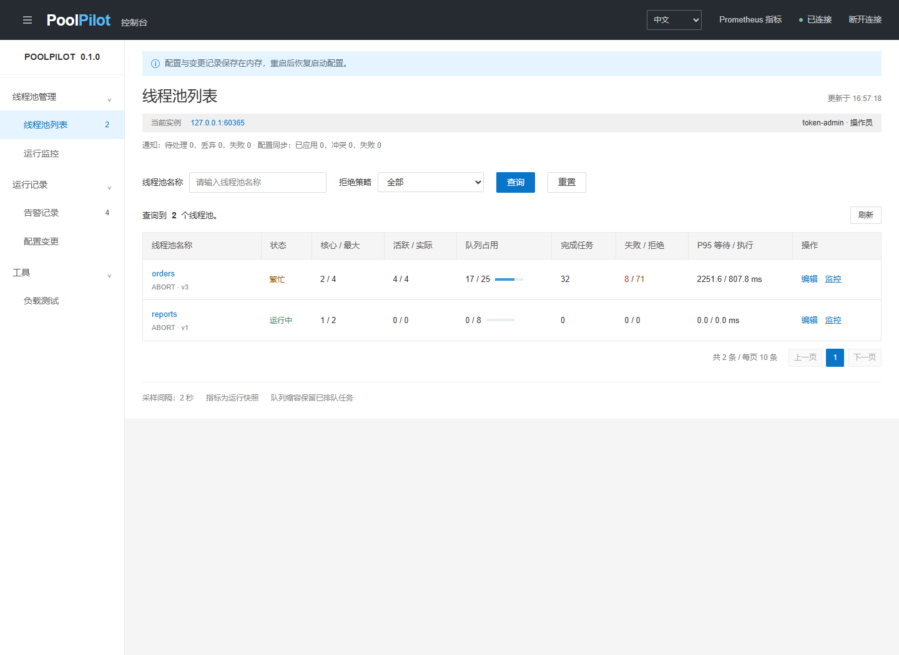

# PoolPilot

[简体中文](README.md) · [English](README.en.md)

[](https://github.com/Htd7860/poolpilot/actions/workflows/ci.yml)

轻量线程池治理工具，提供 Spring Boot／@Async 接入、运行时调参、版本回滚、任务超时监控、外部配置同步和中英文管理台。

基于 Java 17、Spring Boot 3.5.16，已验证 Java 17/21 × Boot 3.4.13/3.5.16。Maven Central 尚未提供本项目工件，接入前需本地构建安装。

## 功能

业务线程池的参数不合适时，可以在同一实例中调整核心线程数、最大线程数、队列容量、空闲存活、核心线程超时、拒绝策略和慢任务阈值。管理台显示实时占用、排队、失败、拒绝事件、慢任务和最近样本延迟。

- 动态队列：缩容保留已有任务，占用低于新容量后才能再次入队。
- 乐观并发控制：变更必须附带配置版本；过期写入返回 409。
- 任务观测：识别 `submit()` 内被 FutureTask 捕获的异常，统计失败与取消。
- 指标接入：Micrometer + Prometheus，执行/等待延迟 histogram。
- 告警：线程活跃、队列占用、拒绝事件、慢任务、排队与运行超时；有界异步通知，公开失败与丢弃统计。
- 配置源：HTTP／Nacos 轮询，应用隔离、修订号去重、本地版本冲突保护与重启恢复。
- 变更记录：前后参数、版本、原因、时间；最近 200 条，可选本地持久化。
- 配置恢复：原子替换状态文件，重启恢复已注册池的配置与版本；存储失败拒绝本次调参。
- 版本回滚：预览当前值与目标值，校验当前版本；恢复所选变更前的完整配置，新增版本与来源审计。
- MDC：提交时捕获、执行后恢复；支持组合有序的 Spring TaskDecorator。
- 生命周期：统一关闭等待期限，超时后中断活动任务并取消未执行的 Future。
- 管理 API：独立可选 starter；支持共享令牌、命名令牌的角色与过期时间、应用认证接入。
- 中英文：菜单、查询、弹窗、告警、校验和 API 错误支持双语；切换保留表单和查询，记住语言偏好，令牌不写浏览器存储。



## 运行

需要完整 **JDK 17 或 21**。Maven Wrapper 自动下载 Maven 3.9.16。先检查 `java -version` 与 `JAVA_HOME`，后者可能指向另一个 JDK。

也可从 [Releases](https://github.com/Htd7860/poolpilot/releases) 下载可执行 JAR，生成并设置管理令牌后直接运行。

Windows PowerShell：

```powershell
# 在项目根目录；按本机路径设置 JDK
$env:JAVA_HOME = 'C:\Program Files\Java\jdk-17'
$env:POOLPILOT_ADMIN_TOKEN = .\scripts\new-admin-token.ps1
Write-Host $env:POOLPILOT_ADMIN_TOKEN
.\mvnw.cmd -B -ntp verify
& "$env:JAVA_HOME\bin\java.exe" -jar .\poolpilot-demo\target\poolpilot-demo-0.1.0.jar
```

Linux / macOS：

```bash
export POOLPILOT_ADMIN_TOKEN="$(openssl rand -hex 32)"
printf '%s\n' "$POOLPILOT_ADMIN_TOKEN"
chmod +x mvnw
./mvnw -B -ntp verify
java -jar poolpilot-demo/target/poolpilot-demo-0.1.0.jar
```

打开 [http://127.0.0.1:8080/poolpilot/index.html](http://127.0.0.1:8080/poolpilot/index.html)，输入上面生成的令牌。应用从 `POOLPILOT_ADMIN_TOKEN` 读取密钥，没有默认值；未配置有效令牌时无法启动管理接口。demo 默认只监听 127.0.0.1，端口占用时加 `--server.port=8081`。Linux / macOS 的生成命令需要 OpenSSL。

页面根据后台认证模式显示登录入口：令牌模式输入部署者配置的密钥；应用认证模式沿用已登录的业务身份与管理权限。

**令牌是管理 API 的访问密钥**，请求通过 `X-PoolPilot-Token` 携带，不参与业务任务执行。共享令牌的所有持有者都能调参，审计身份为 `token-admin`。多人使用时可配置命名令牌：只读或操作员角色、SHA-256 摘要、可选过期时间，审计记录对应用户名。也可接入应用的已认证身份。详见 [治理配置](docs/governance.md)。页面只在内存保存令牌，刷新后需重新连接。

也可使用 `scripts/run-demo.ps1`；默认从当前 PATH 的 Java 查询 JDK 路径，可显式传入 `-JavaHome`。

## 调参示例

1. 连接管理台，进入“负载测试”，选择 `orders`，点击“提交队列拥堵”。
2. 观察队列、拒绝事件与告警；已被拒绝的任务不会自动重新提交。
3. 返回“线程池列表”，点击 `orders` 行的“编辑”，将核心线程数改为 4、最大线程数改为 8、队列容量改为 32，填写原因并保存。
4. 再次提交相同演示负载，对比占用变化；查看变更记录中的配置前后值。需要撤销时，在详情中选择“回滚本次变更”，审阅目标配置，填写原因后确认。
5. 在“负载测试”中提交“部分失败”或“慢任务”，然后查看“运行监控”和“告警记录”。

线程池列表支持名称和策略查询；运行监控展示当前池的统计与队列趋势；告警与变更记录支持筛选和分页；变更详情展示参数差异。

右上角与弹窗内可切换 `中文 / English`。首次访问按浏览器语言选择；之后只在 localStorage 保存 `poolpilot.locale`。未保存的参数、变更原因、筛选条件和登录令牌输入不会因切换丢失，用户输入的内容不翻译。

左上角菜单按钮可收起整个导航，让内容区扩展到全宽；桌面侧栏的分组也可单独折叠。手机端保留横向导航，并支持整体收起与展开。

负载接口限制 200 个任务、单任务 2 秒，仅支持 ABORT。功能演示不能用于推算生产吞吐量。性能实验见 [JMH 基准](benchmarks/README.md)。

## 接入自己的 Spring Boot 应用

先在项目根目录执行 `./mvnw install`（Windows 使用 `mvnw.cmd`），将本地工件安装到 Maven 本地仓库，再加入依赖。需要页面/API 时选 admin starter；只需后台治理时选 `poolpilot-spring-boot-starter`，基础 starter 不传递 MVC，管理 API 默认关闭：

```xml
<dependency>
  <groupId>dev.poolpilot</groupId>
  <artifactId>poolpilot-spring-boot-admin-starter</artifactId>
  <version>0.1.0</version>
</dependency>
```

```yaml
poolpilot:
  pools:
    - name: order-io
      core-size: 4
      max-size: 8
      queue-capacity: 64
      keep-alive-seconds: 60
      allow-core-timeout: false
      rejection-policy: ABORT
      slow-task-millis: 1000
  admin:
    enabled: true
    token: ${POOLPILOT_ADMIN_TOKEN}
  persistence:
    enabled: true
    path: ./data/poolpilot-state.json
```

```java
@Service
public class OrderService {
    private final ManagedThreadPool executor;
    public OrderService(ManagedPoolRegistry registry) {
        this.executor = registry.get("order-io");
    }
    public CompletableFuture<String> load() {
        return executor.submitStage(() -> "business result");
    }
}
```

示例类型来自 `dev.poolpilot.core`，Spring 注解来自 Spring Framework。`submitStage` 保留业务失败统计，取消排队任务时回收容量。使用 `PoolPilotTaskExecutor` 可保留 `@Async("orderExecutor")` 的调用方式，示例见 [治理配置](docs/governance.md)。第三方执行器和 Tomcat 需要专用适配；不会自动替换已有实例。

## 配置持久化与回滚

starter 的持久化默认关闭；demo 默认开启，路径为工作目录下的 `data/poolpilot-state.json`，可通过 `POOLPILOT_STATE_PATH` 更改，通过 `POOLPILOT_PERSISTENCE_ENABLED=false` 关闭。管理台连接后显示实际保存方式。

通过 registry 或管理 API 调参时，保存完整配置、版本和最近 200 条变更。文件不保存令牌、排队任务、运行统计或告警。重启只恢复 YAML 或代码明确注册的同名池，不自动创建已移除的池；已保存的同名配置优先于 YAML。回滚记录也会保存。

本地文件加独占锁防止多个实例共用路径，使用临时文件、文件同步与原子替换；写失败返回 503，本次变更不生效，版本与历史不推进。无法读取、内容损坏或不支持的格式会使启动失败，保留原文件；修复或备份后移开文件才能恢复 YAML。需要支持原子移动的本地文件系统，文件同步不能保证所有断电场景；这不是集群配置或数据库事务。容器重建后若要保留状态，应把可写目录挂载为持久卷。

回滚以所选记录的 `before` 为完整目标，**可能撤销其后多次调参**；管理台先展示当前值与目标值。它仍校验 `expectedVersion`，并创建一个递增的新版本和 `ROLLBACK` 记录，附 `sourceChangeId`。已超出 200 条保留范围的变更不能再直接回滚。更多设计与恢复语义见 [架构](docs/architecture.md)。

## REST API

`GET /poolpilot/api/auth` 可匿名读取认证模式，仅返回 `TOKEN` 或 `APPLICATION`；关闭管理接口后不提供此端点。其余令牌模式的 `/poolpilot/api/**` 请求携带 `X-PoolPilot-Token`；应用认证模式使用已验证的 Principal 与角色。读取接口允许只读账号，写入需要操作员权限。静态页面不含业务数据，Actuator 端点需由应用另行保护。

| 方法 | 路径                                 | 功能                                        |
| ---- | ------------------------------------ | ------------------------------------------- |
| GET  | /poolpilot/api/config-sources        | Configuration refresh status / 配置同步状态 |
| GET  | /poolpilot/api/notifications         | Notification delivery statistics / 通知统计 |
| GET  | /poolpilot/api/pools/{name}/sources  | Accepted source revisions / 已接受的修订号  |
| GET  | /poolpilot/api/info                  | 存储、身份、通知与配置同步状态              |
| GET  | /poolpilot/api/pools                 | 所有线程池快照                              |
| GET  | /poolpilot/api/pools/{name}          | 一个线程池快照                              |
| PUT  | /poolpilot/api/pools/{name}          | 完整替换配置，附版本与原因                  |
| POST | /poolpilot/api/pools/{name}/rollback | 回滚所选变更，附当前版本与原因              |
| GET  | /poolpilot/api/alerts                | 最近告警，最新在前                          |
| GET  | /poolpilot/api/changes               | 最近配置变更，最新在前                      |
| POST | /poolpilot/api/demo/load             | 仅 demo 模块提供的演示负载                  |

```json
{
  "expectedVersion": 1,
  "reason": "提高订单聚合的并行容量",
  "settings": {
    "coreSize": 4,
    "maxSize": 8,
    "queueCapacity": 32,
    "keepAliveSeconds": 60,
    "allowCoreTimeout": false,
    "rejectionPolicy": "ABORT",
    "slowTaskMillis": 400
  }
}
```

401 表示认证无效，403 表示没有写入权限，400 表示请求或参数错误，404 表示池或保留的变更不存在，409 表示版本冲突或线程池已关闭，503 表示配置保存失败。发生 409 后读取最新配置，再重新提交明确的修改，不能盲目覆盖。API 支持 `Accept-Language: zh-CN` / `en-US`；错误包含稳定的 `code`、本地化 `error` 和 `parameters`，版本冲突附当前版本。告警包含结构化 `kind`、`value` 与本地化 `message`。

回滚请求示例（`changeId` 来自变更列表，`expectedVersion` 来自当前快照）：

```json
{
  "changeId": 1,
  "expectedVersion": 2,
  "reason": "扩容效果不符合预期，恢复原配置"
}
```

## 指标与运行语义

- `submitted` 是提交尝试数；`rejected` 是触发拒绝处理的次数。CALLER_RUNS 同时增加 rejected 与 callerRuns，任务仍可能成功执行。
- `activeCount` 是 JDK worker 活跃数；`tasks.running` 包含调用方执行的任务。二者不同。
- `completed` 包含成功、失败与被工具观测到的取消。它不等于仅成功任务数；取消排队任务可能使 completed 大于 started。
- 页面 P95/P99 为最近 **256 个完成样本**的最近秩百分位，包含已观测取消的零执行时长；不是请求端到端延迟，也不是 Prometheus 的全局百分位。
- 正常取消排队 Future 后可调用 `purge()` 回收队列容量；取消活跃 Future 只会尝试中断，任务是否退出取决于任务对中断的响应。
- `remove(originalRunnable)` 可识别包装前的原始任务；已取消 Future 的删除只计数一次。自定义 TaskDecorator 应在当前执行线程同步调用原任务一次；装饰器失败时直接提交的 Future 会被取消，避免无限等待，并记录失败。
- 启动后通过 `registry.register(...)` 新增的池会自动绑定指标；单实例最多 32 个池。`submitOrReject(Callable)` 强制拒绝而不执行 CallerRuns，适合必须保护提交线程的调用。
- `CompletableFuture.supplyAsync(..., pool)` 获得排队、耗时和拒绝观测。业务异常通过 `whenComplete` 记录；池无法直接读取其内部结果或自动清除已取消的内部任务。
- 超时监控跟踪未完成任务，默认每 250 ms 扫描，每池最多 10000 条；排队/运行阈值默认 10 s / 30 s。它只观测，不中断或取消业务任务。冷却会抑制通知，超时计数仍保留。
- 通知在线程池中异步执行，队列有界；堵塞或失败不会拖慢采样。没有持久投递、重试或送达保证。

Prometheus 在 demo 中可访问 `/actuator/prometheus`。指标名见 [架构与语义](docs/architecture.md)。执行延迟示例查询：

```promql
histogram_quantile(0.95,
  sum by (le, pool) (rate(poolpilot_task_execution_seconds_bucket{outcome="success"}[5m]))
)
```

如需增加通知渠道，实现 `PoolAlertListener` 并声明 Spring Bean。默认告警写本地日志与管理台，不自动向外发送消息。

## 模块

```text
poolpilot-core                 JDK 并发原语、动态队列、统计、版本与生命周期
poolpilot-spring-boot-starter        自动配置、MDC、@Async、超时、配置源与指标
poolpilot-spring-boot-admin-starter  可选管理 API、权限与管理台
poolpilot-demo                 可控负载、Prometheus、完整 HTTP 集成验证
benchmarks                     独立 JMH 工程：读取、提交、队列竞争与批量清理
```

测试覆盖队列扩缩容、阻塞/中断、丢任务风险、调参顺序、并发写冲突、Future 异常、强制关闭、MDC 清理、告警冷却、鉴权与 HTTP 接口。CI 配置 Java 17 / 21、Linux / Windows；本地执行结果见 [验证记录](docs/validation.md)。

可选浏览器验收需要 Node.js 22+：执行 `npm ci`，在关闭持久化的独立 demo 实例上运行 `npm run test:browser`，默认使用已安装 Chrome；也可下载 Chromium 并设置 `POOLPILOT_BROWSER=chromium`。测试会调整 `orders` 配置并更新截图，覆盖操作流程、中英文、表单保留、语言持久化和手机排版。

构建附件和发布步骤见 [发布说明](docs/releasing.md)，版本变化见 [CHANGELOG](CHANGELOG.md)。

## 部署与接入要求

PoolPilot 管理当前 JVM 中的线程池，外部配置源可向多个实例提供相同文档；每个实例独立校验版本并保存状态，不提供中心化集群控制台。命名令牌区分用户与读写角色；已有认证可通过 Principal 或 AdminAuthenticator 接入。运行统计、排队任务和告警保存在内存。配置中心接入条件见 [治理配置](docs/governance.md)，兼容性与性能差异见 [与 dynamic-tp、Hippo4j 的对比](docs/comparison.md)。

需要审计和持久化的治理变更必须通过 registry 或管理 API 完成，直接调用 pool.reconfigure() 或继承的 JDK setter 会绕过存储与审计。多个属性按安全顺序设置，任务提交仍继续，底层执行器不是一次原子修改所有属性。慢任务阈值按完成时配置评估。

## 开源来源与许可

Apache License 2.0。功能设计参考 [dynamic-tp](https://github.com/dromara/dynamic-tp) 与 [Hippo4j](https://github.com/opengoofy/hippo4j)。Maven Wrapper 由 Apache Maven 官方插件生成，保留原有许可声明。详见 [NOTICE](NOTICE)。
