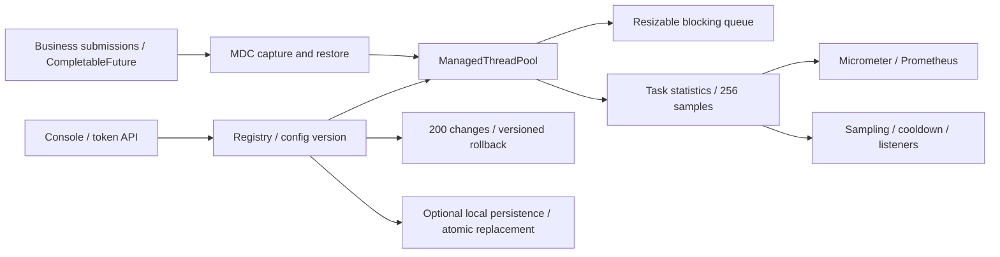

# Architecture and semantics

[简体中文](architecture.md) · [English](architecture.en.md)

The core depends only on the JDK. The base starter creates pools from YAML, composes MDC/Spring decorators, binds metrics and manages timeout/configuration scans without MVC. The separate admin starter provides the optional API and console. The API queries registered pools, changes settings and records versions and audit entries.

## Queue and configuration

One ReentrantLock protects the queue contents, capacity and two conditions. Expansion wakes producers; shrinking preserves elements. `offer` rejects and `put` waits while size is at least capacity. Remaining capacity is clamped to zero. Removal / drain / clear wake producers when appropriate. Iterators use a snapshot; `drainTo` adds before removing so a target collection failure does not discard untransferred work.

JDK submission order remains core threads → queue → max threads → rejection handler. Increasing queue capacity does not necessarily increase concurrency.

New pools start at version 1; persisted pools restore their saved version. The registry serializes configuration changes and audit creation. Validation and stale-version rejection happen before mutation. When reducing max below the old core, core is reduced first; when increasing core, max is increased first. Core timeout is disabled before allowing zero keep-alive. Snapshots and reconfiguration share a lock; task execution continues independently. Direct inherited setters bypass governance, and multi-attribute executor updates are not atomic with task submissions.

## Failures and cancellation

The wrapper retains original and decorated tasks. After a directly submitted FutureTask completes, its result reveals exceptions that `run()` itself captures. Ordinary Runnable exceptions are recorded and retain JDK propagation. CompletableFuture and nested ExecutorCompletionService tasks may capture business results elsewhere; inspect those results separately.

`shutdownNow` cancels queued original Futures and returns original tasks. Running tasks are interrupted, not forcibly terminated. `purge` filters original Future cancellation state in one locked pass, preserving order and recording cancellation outside the queue lock; `remove` recognizes original queued tasks. CAS guards prevent duplicate completion / cancellation accounting. Removing a non-cancelled task does not cancel its Future: the caller remains responsible for it, as with the JDK executor.

TaskDecorator must invoke the task synchronously once. If it fails before a direct Future completes, that Future is cancelled to avoid indefinite waits while statistics record the decorator failure. Observer runtime exceptions are isolated and counted as observer failures. Observers execute on the completing thread and should return promptly.

CALLER_RUNS provides backpressure by using the submitting thread. Rejection events still increment. Shutdown always rejects rather than silently abandoning a Future. `submitOrReject` forces abort semantics per submission even if the configured policy changes; the demo uses it to protect the HTTP thread.

## Context and metrics

MDC is captured on submission, applied at execution and restored in a finally block. Ordered Spring TaskDecorator beans compose inside the MDC wrapper. Other ThreadLocals and SecurityContext require application decorators; database transactions are not propagated.

| Metric                                                     | Type            | Meaning                                                 |
| ---------------------------------------------------------- | --------------- | ------------------------------------------------------- |
| poolpilot.pool.active / size / core / max                  | Gauge           | Active, current, core and maximum workers               |
| poolpilot.queue.size / capacity / remaining                | Gauge           | Queue occupancy, capacity and free capacity             |
| poolpilot.config.version                                   | Gauge           | Governance version                                      |
| poolpilot.tasks.submitted / completed / failed / cancelled | FunctionCounter | Attempts, observed completion, failure and cancellation |
| poolpilot.tasks.rejected / caller.runs / slow              | FunctionCounter | Rejection events, caller execution and slow tasks       |
| poolpilot.task.wait                                        | Timer           | Queue wait; includes observed cancellation              |
| poolpilot.task.execution                                   | Timer           | Execution duration, outcome=success/failure/cancelled   |

All meters use a bounded `pool` tag; execution timers add `outcome`. No trace or user IDs are metric tags. Registration observation atomically replays existing pools and subscribes to later ones; closing the binder unsubscribes, removes observers and unregisters its meters. UI sample percentiles are independent of Prometheus histograms.

FunctionCounters read individual LongAdders directly. Capacity and configuration version also use direct reads. API and alert snapshots retain percentile calculations, cached until samples change. Independent meter reads do not form a consistent multi-field snapshot. See the [JMH experiments](../benchmarks/README.md) for read overhead.

## Alerts, storage and localization

A daemon samples with fixed delay. Cooldown uses monotonic nanoTime; display timestamps use Instant. Rejection / slow-task values are interval deltas, while thread / queue values are sampled utilization. Cooldown keys are pool + type. Events are stored before listeners run, with 200 alerts and 200 changes retained. Listeners run on a separate bounded executor: one worker, 128 queued events and 1000 ms shutdown wait by default. Saturation drops new delivery jobs and increments counters. Shutdown interrupts active jobs and discards queued jobs after its deadline; interrupt-ignoring daemon listeners may continue. Sampling and close do not wait for them. There is no durable delivery or retry guarantee.

Alert `kind` and numeric `value` make messages localizable. The API follows Accept-Language and provides stable error codes. The console uses a local catalog with plain-text DOM updates, stores only the language preference, and preserves form values and user-written audit reasons when switching.

## Primary references

- [dynamic-tp](https://github.com/dromara/dynamic-tp), [Hippo4j](https://github.com/opengoofy/hippo4j): functional references.
- [JDK ThreadPoolExecutor](https://docs.oracle.com/en/java/javase/17/docs/api/java.base/java/util/concurrent/ThreadPoolExecutor.html), [BlockingQueue](https://docs.oracle.com/en/java/javase/17/docs/api/java.base/java/util/concurrent/BlockingQueue.html): executor, rejection, blocking and interruption semantics.
- [Spring Boot auto-configuration](https://docs.spring.io/spring-boot/3.5/reference/features/developing-auto-configuration.html), [metrics](https://docs.spring.io/spring-boot/3.5/reference/actuator/metrics.html): starter registration and observation integration.

See the [source comparison](comparison.en.md) for executor adaptation, alerts, configuration refresh and performance differences.

## Local state and rollback

The core exposes `PoolStateStore`; its default implementation disables persistence. The starter provides `FilePoolStateStore` with a private JSON mapper, schema version 1 and a 1 MiB document limit. It validates settings, versions, event ordering and agreement between the latest change and saved configuration. Unknown schemas, corruption, repeated event IDs and implicit string / fractional integer conversions are rejected.

Registry writes are serialized. Under the pool configuration lock, the version and shutdown state are checked before writing the candidate state. Validated parameters are then applied and the audit is appended. Ordinary storage failure does not change the pool or advance versions. Shutdown shares this lock. Task submissions continue; there is no atomic multi-property transition relative to submissions, or disk / executor transaction guarantee during JVM failure or resource exhaustion. Direct pool.reconfigure() calls bypass persistence and auditing.

The registry owns the exclusive file lock. Its lock file is left in place to avoid lock-path deletion races. A same-directory temporary file is synchronized with force(true) before ATOMIC_MOVE, without a non-atomic fallback. Use a reliable local filesystem and separate paths per instance. Network filesystems and power-loss recovery have not been verified.

Only explicitly registered names restore saved settings and versions. Removed configuration pools are not recreated. The next save contains current registered pools; the newest 200 audit entries remain, including removed-pool history. Counters, queued tasks, alerts and tokens are not persisted.

Rollback restores a retained entry's complete before settings through the same registry write path, with a current expectedVersion and new reason. It creates a new version and an immutable ROLLBACK entry referencing sourceChangeId. The source must belong to the pool; expired history returns 404, version conflicts 409, and persistence failure 503. The console loads a current snapshot for review; conflicts require explicit refresh and another confirmation.

## Async integration, timeouts, sources and identity

`submitStage` links CompletableFuture to the original FutureTask, exposing business failures and removing cancelled queued work. PoolPilotTaskExecutor delegates Spring @Async to the same registry-owned pool. Timeout scans are independent of configuration snapshots; tracking is bounded and each task phase produces at most one timeout event, cleaned on completion/rejection/removal.

External changes validate application, source revision and local expectedVersion before registry persistence/auditing. Revisions are saved with configuration; legacy schema-1 files without this field restore an empty map. Named tokens use constant-time digest comparison; roles protect every management write and audit names come from authentication. Application mode uses an upstream-verified Principal and roles. See [governance](governance.en.md) for properties and additional metrics.
