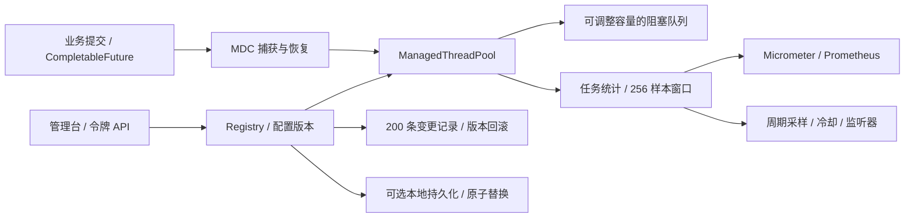

# 架构

[简体中文](architecture.md) · [English](architecture.en.md)

## 架构

核心模块只依赖 JDK。starter 将 YAML 转成完整 PoolSettings，创建 ManagedPoolRegistry，添加 MDC 与有序 Spring 装饰器、Micrometer、超时扫描和外部配置轮询。基础 starter 不依赖 MVC；管理 API 与页面由 admin starter 提供。管理接口查询已注册池，修改配置并记录版本与审计。

## 动态队列

队列使用同一 ReentrantLock 保护容量、元素和两个 Condition。扩容唤醒生产者；缩容不删除元素；当 size ≥ capacity 时 offer 拒绝、put 等待。remainingCapacity 最小为零。take/poll/remove/drainTo/clear 会按需要唤醒生产者。

ThreadPoolExecutor 的一般提交顺序仍是：核心线程 → 入队 → 最大线程 → 拒绝处理。增加队列容量并不一定增加并行度；如果想更早扩展到 max，需要结合核心线程和队列策略理解。

Iterator 使用快照，remove 对应地删除当前队列中的元素。drainTo 先向目标集合添加再删除队首，目标抛异常时未转移元素保留。

## 配置版本与顺序

新池版本从 1 开始，持久化池恢复原有版本。registry 将变更、版本检查与审计记录串行处理；API 使用 expectedVersion。校验失败或版本过期不会修改参数。

缩小最大线程到旧核心以下时先减核心；增加核心时先提高最大线程。关闭核心超时后才允许存活时间归零。所有参数校验完成后执行 setter。snapshot 和治理变更共用配置锁，底层任务执行不持有该锁。

这保证 API 之间的冲突控制，不代表外部直接调用 JDK setter 也受治理，不保证正在提交任务时多属性同时瞬间改变。

## 任务失败与取消

execute 统一包装提交任务，保留 original 与 decorated 两个引用。FutureTask 把用户异常放进 Future，因此 wrapper 在 run 返回后，检查已完成 Future 的结果，再决定成功、失败或取消。普通 Runnable 抛出的运行时异常计入失败后继续遵循 JDK 异常传播。

这个检查覆盖直接 `submit()` 的 FutureTask。CompletableFuture 的内部异步 Runnable、ExecutorCompletionService 的嵌套包装等会另外保存业务结果，线程池不能普遍反射或读取其内部状态。这类提交仍获得耗时与队列观测，但业务失败需要调用方通过结果回调单独记录；不能将池的 failed=0 解读成所有异步业务成功。

shutdownNow 对未执行的包装任务取消 original Future，避免关闭后调用方永远等待排队 Future。正在运行的任务仅尝试中断，不能终止忽略中断的代码。purge 在同一次持锁扫描中按 original Future 的取消状态清理队列，保留剩余顺序，解锁后记录取消并唤醒生产者。单个任务用 CAS 避免重复记录。

remove 可识别原始任务；删除未取消的任务时仍由调用方处理其 Future。TaskDecorator 应同步执行原任务一次；装饰器在直接提交的 Future 完成前失败时取消该 Future，避免永久等待，统计记为失败。submitOrReject 逐次提交强制 ABORT，即使遇到并发策略变更也不会在 HTTP 线程执行演示任务。

TaskObserver 的 RuntimeException 会被隔离并计入 observerFailures；观测代码仍运行在任务完成线程，应快速返回。CALLER_RUNS 在提交线程执行，既是背压也会延长调用者响应时间。

## 上下文

MDC 在提交时捕获；开始任务时记住当前执行线程已有的 MDC，应用捕获值，finally 恢复原值。它不复制任意 ThreadLocal，不传播数据库事务或默认传播 SecurityContext。Spring TaskDecorator Bean 按顺序组合，MDC 位于最外层；额外上下文由应用的装饰器负责。

## 指标

| 指标                                                       | 类型            | 含义                                             |
| ---------------------------------------------------------- | --------------- | ------------------------------------------------ |
| poolpilot.pool.active / size / core / max                  | Gauge           | 活跃、实际、核心、最大线程数                     |
| poolpilot.queue.size / capacity / remaining                | Gauge           | 队列长度、容量、可用容量                         |
| poolpilot.config.version                                   | Gauge           | 当前治理版本                                     |
| poolpilot.tasks.submitted / completed / failed / cancelled | FunctionCounter | 提交尝试、已观测完成、失败、取消                 |
| poolpilot.tasks.rejected / caller.runs / slow              | FunctionCounter | 拒绝处理、调用方执行、慢任务                     |
| poolpilot.task.wait                                        | Timer           | 入队到开始的等待；含已观测取消                   |
| poolpilot.task.execution                                   | Timer           | 执行耗时，标签 outcome=success/failure/cancelled |

所有指标固定标签 pool；执行 Timer 额外有 outcome。池名受数量与长度限制，不将 traceId 等无界字段放进标签。UI 的最近样本百分位与 Prometheus histogram 独立；百分位不是性能承诺。

FunctionCounter 直接读取对应 LongAdder，容量和版本读取对应字段，不调用完整 snapshot。配置快照仍用于 API 与告警采样；它包含最近 256 个样本的百分位，只有样本更新后才重新排序。各计数器读数独立采样，不保证跨字段一致。读取开销见 [JMH 实验](../benchmarks/README.md)。

指标绑定原子回放已有池并订阅运行时注册，关闭时取消订阅、移除任务观察器并解绑指标。注册监听器异常隔离并记录日志，已注册线程池仍可工作。

## 告警与存储

告警使用单个后台 daemon 线程固定延迟采样，冷却按 System.nanoTime，展示时间按 Instant。拒绝/慢任务是上次采样到本次的增量；活跃与队列是当前占用。冷却键为 pool + type。事件先写内存日志再调用监听器。

告警与变更各保留 200 条。监听器在独立有界执行器中异步调用，默认 1 个通知线程、128 个等待事件、1000 ms 关闭等待。队列满时丢弃新通知并计数；关闭超时中断活动通知并丢弃等待通知。忽略中断的监听器仍可能继续运行，但不阻塞 close 返回。事件没有持久化、重试或送达保证。配置与变更可以启用本地持久化。

告警保留 kind 与数值 value，API 按 Accept-Language 生成 message。错误有稳定 code 与本地化 error。前端字典只修改文本，切换保留输入、筛选和版本，只存语言偏好；管理令牌不持久化，用户变更原因不翻译。

## 参考来源

- [dynamic-tp](https://github.com/dromara/dynamic-tp)：治理、监控、告警、扩展点的功能参考。
- [Hippo4j](https://github.com/opengoofy/hippo4j)：运行参数管理与变更观测的功能参考。
- [JDK ThreadPoolExecutor](https://docs.oracle.com/en/java/javase/17/docs/api/java.base/java/util/concurrent/ThreadPoolExecutor.html)：线程增长、队列与拒绝语义。
- [JDK BlockingQueue](https://docs.oracle.com/en/java/javase/17/docs/api/java.base/java/util/concurrent/BlockingQueue.html)：阻塞、中断、集合操作约定。
- [Spring Boot 自动配置](https://docs.spring.io/spring-boot/3.5/reference/features/developing-auto-configuration.html)：AutoConfiguration.imports 与条件配置。
- [Spring Boot Metrics](https://docs.spring.io/spring-boot/3.5/reference/actuator/metrics.html)：Micrometer 注册与 Prometheus 接入。

执行器适配、告警、配置刷新与性能差异见 [源码对比](comparison.md)。

## 本地状态与回滚

`PoolStateStore` 是 core 的存储接口，默认禁用；starter 的 `FilePoolStateStore` 使用独立 JSON mapper，文档格式版本为 1，最大 1 MiB。读取校验参数范围、版本、事件顺序及最新配置一致性，拒绝未知格式、损坏内容、重复事件 ID、数字字符串与小数到整数的隐式转换。

registry 串行处理治理写入；池配置锁内先校验 expectedVersion 和关闭状态，再写入候选状态，最后按安全顺序应用参数并添加审计。普通存储失败不会修改池或推进版本；关闭与变更共享配置锁。任务提交仍继续，不保证多属性相对任务提交原子生效，也不对 JVM 崩溃或资源耗尽提供跨磁盘与执行器事务保证。需要持久化的写入必须经过 registry，直接调用 pool.reconfigure() 不会存储或记审计。

文件锁伴随 registry 生命周期释放；固定锁文件不主动删除，避免删除后的锁路径竞争。临时文件与目标文件同目录，写完执行 force(true)，再 ATOMIC_MOVE；不降级为非原子替换。需要可靠的本地文件系统，未验证网络盘或断电恢复。多实例应使用各自的状态文件。

启动仅为明确注册的同名池应用保存的版本和参数，避免让已删除的配置池再次出现。下次写入只保存当前注册池；最近 200 条历史仍保留，包括已移除池的审计。运行指标、排队任务、告警和令牌不保存。

回滚使用保留记录的 before 全量参数，提交当前 expectedVersion 和新原因，仍走同一治理写入流程。它创建新版本并记录 ROLLBACK 与 sourceChangeId，不修改旧记录。所选记录必须属于当前池；记录过期返回 404，版本冲突返回 409，存储失败返回 503。管理台先拉取当前快照显示差异，冲突后明确刷新并重新确认。

## 异步接入、超时、外部配置与身份

`submitStage` 将 CompletableFuture 连接到原始 FutureTask，暴露业务异常；取消排队 stage 时调用 remove 回收容量。`PoolPilotTaskExecutor` 把 Spring @Async 委托到同一 registry 池，生命周期由 registry 管理。超时扫描独立于配置快照；每个任务按排队和运行阶段各记录一次，跟踪有界，结束/拒绝/清理时移除。

外部配置先校验应用、源修订号和本地 expectedVersion，再通过 registry 的持久化与审计流程写入。源修订号与配置一同保存；旧的 schema 1 文件缺少该字段时使用空 map。命名令牌使用摘要恒定时间比较，角色保护所有管理写入，操作人来自认证结果；应用模式读取经过上游认证的 Principal/角色。配置与指标明细见 [治理配置](governance.md)。
